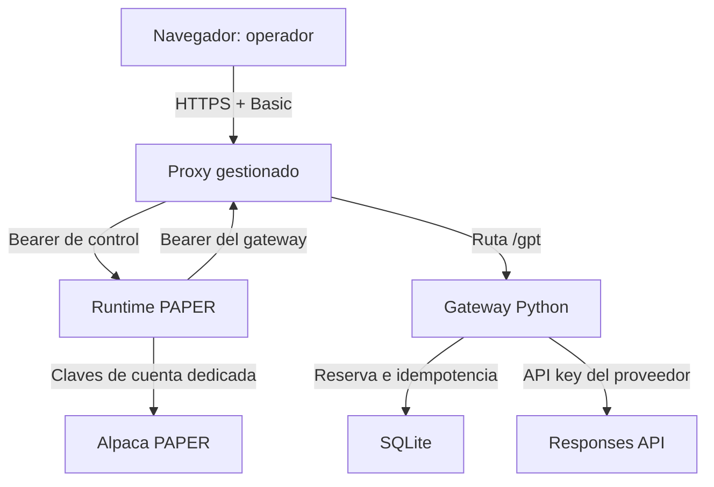

# HARPOON 24.3.1 — autenticación e inferencia

Revisión del 13 de octubre de 2026, hora de Ciudad de México. Implementación y pruebas locales; sin despliegue ni inferencia real.

## Procedencia y alcance

GitHub identificó la cuenta `masivarecords-ship-it`, con los repositorios públicos `HerpoonX` y `gestor-de-oficios`. Ambos devolvieron explícitamente «This repository is empty». La conexión activa es `Blyat2020` y, sobre esos repositorios, informa `pull:true`, `push:false`, `admin:false`.

Se infiere **HerpoonX** como destino probable por el antecedente HARPOON. Esa relación no está confirmada por contenido del repositorio. Esta entrega procede del archivo existente **HARPOON_Cloud_247.zip**, no de un commit de GitHub. No se publicó código ni se cambió el acceso a ninguna cuenta. El archivo original permanece separado; esta es una copia corregida.

`evidence/source_review.json` identifica el archivo de partida y su hash. `CHANGES.patch` contiene los cambios de los archivos de código ya existentes. `MANIFEST.json` verifica la entrega, incluidas pruebas, documentación y el HTML recuperado.

## Componentes

| Componente | Función | Fuente revisada |
|---|---|---|
| Panel y proxy gestionado | Valida Basic del operador; separa rutas `/crypto`, `/equity`, `/gpt`; sustituye credenciales externas por el token interno apropiado. | `deploy/managed.cjs`, funciones `basicAuth`, `edge`, `main`; `deploy/dashboard.html` |
| Runtime de trading | Valida bearer de control y encabezado de acción. Conserva cuenta dedicada, conciliación, PAPER y pausas. | `runtime/cloud.cjs`, `runtime/control.cjs` |
| Gateway de investigación | Valida bearer, presupuestos y contratos; es el punto de acceso común a Responses API para HOT y COLD. | `service/server.py`, `Gateway`, `handler`; `service/supervision.py` |
| Gateway integrado opcional | Sirve el HTML original y ofrece sesión con cookie, CSRF y bóveda de configuración. | `service/app24.py`, `Sessions`, `IntegratedGateway`, `integrated_handler` |
| Clientes del HTML original | Cargan la sesión integrada o usan URL y bearer del gateway externo; guardan credenciales locales en IndexedDB cifrado. | `src/gateway24_app.js`, `src/supervision.js`, `src/lab_controller.js`, `src/io.js` |

**El despliegue de `render.yaml` arranca `deploy/managed.cjs`, que ejecuta `service/server.py`. No arranca `service/app24.py`.** Las sesiones del gateway integrado no son la autenticación del panel cloud. El Copiloto de Sites conservado dentro del ZIP original es otra adaptación; no se presenta aquí como una función del panel cloud.

En las rutas cloud revisadas no hay OAuth, JWT, refresh tokens, registro de usuarios ni roles individuales. Existe una identidad administrativa compartida y dos secretos internos. Que el proveedor sea OpenAI no convierte su API key en la contraseña del panel.

## Flujo del panel y de las solicitudes



1. El operador abre el panel HTTPS. El navegador envía `Authorization: Basic base64(trader:contraseña)`. Base64 es una codificación; TLS es quien protege el transporte externo. La contraseña del panel requiere al menos 32 caracteres en el lanzador gestionado.
2. `basicAuth` exige el esquema y base64 canónico, y compara el valor con `timingSafeEqual`. `/healthz` es una excepción pública de vida del proceso; no acredita autenticación, feeds, salud del bróker o inferencia.
3. El proxy rechaza orígenes distintos del origen configurado y `Sec-Fetch-Site: cross-site` en el acceso del panel. Las acciones requieren `X-Harpoon-Action: 1` y JSON de hasta 30 KB. Se conservan clientes no navegador sin `Origin`, que deben presentar autenticación y encabezado de acción. Este encabezado fijo no es un token CSRF de sesión.
4. Para `/crypto/v1/...` o `/equity/v1/...`, el proxy reenvía únicamente el bearer de control a `127.0.0.1`. El runtime vuelve a comprobarlo y aplica sus barreras operativas. Autenticarse no elimina conciliación, bloqueos o límites del motor.
5. Para `/gpt/v1/...`, Basic no es válido: se exige el bearer del gateway. El runtime usa ese secreto para investigación y supervisión. El gateway recibe la API key de OpenAI, pero no las claves del bróker ni la contraseña del panel.
6. `Gateway.submit` valida el trabajo, su ID y límites antes de reservar presupuesto en una transacción SQLite. Repetir el mismo ID y contenido devuelve el trabajo existente; cambiar su contenido con el mismo ID se rechaza.
7. HOT y COLD utilizan `Gateway.responses`. Se envían modelo configurado, esquema JSON estricto y contexto acotado al endpoint fijo `https://api.openai.com/v1/responses`. El transporte rechaza redirecciones; no tiene herramientas de órdenes ni ejecuta código del modelo.
8. Una salida válida se registra con uso y coste estimado a las tarifas configuradas. Un timeout o resultado incierto conserva la reserva y no reenvía automáticamente la generación. Los clientes consultan el mismo ID para conciliar su estado.

## Credenciales y tokens

| Elemento | Ubicación y envío | Vigencia / revocación |
|---|---|---|
| Contraseña del panel | `HARPOON_PANEL_PASSWORD`, en el entorno del supervisor; Basic del navegador al proxy HTTPS. No se entrega a los procesos hijos. | Sin vencimiento automático. Cambiar el secreto del alojamiento y reiniciar el proceso invalida la contraseña anterior. Basic no ofrece logout fiable ni revocación por dispositivo. |
| Token de control | 32 bytes aleatorios, representados como 64 caracteres hexadecimales; archivo privado `control-token`, modo `0600`, bajo el directorio persistente. Se envía al runtime por bearer. | Estático; no es JWT. Una rotación exige actualizar el archivo y reiniciar coordinadamente proxy y runtimes. No se efectuó rotación. |
| Token del gateway | Generado de la misma manera en `gateway-token`; pasa a gateway y runtimes mediante entorno explícito. | Estático y compartido: permite trabajos, lecturas y cambios de política del gateway. No hay scopes por cliente ni refresh automático. |
| API key de OpenAI | En el entorno del gateway gestionado; se envía por bearer al endpoint fijo del proveedor. En el gateway integrado opcional se guarda cifrada en `gateway.enc` mediante Fernet. | Se gestiona en el proveedor y en el alojamiento. El gateway no puede emitir ni renovar claves de OpenAI. |
| Claves Alpaca | Secretos del alojamiento o archivos montados privados en Compose; únicamente el runtime correspondiente las utiliza para su cuenta PAPER. | La revocación pertenece a Alpaca. Dos libros requieren cuentas dedicadas distintas en este instalador. |
| Cookie integrada | `harpoon24_session`: identificador aleatorio de 32 bytes; sesión guardada en memoria del proceso. `HttpOnly`, `SameSite=Strict`, `Secure` bajo origen HTTPS. | 12 horas por defecto. Logout borra la sesión y expira la cookie. Reiniciar el proceso elimina todas las sesiones; no revoca el bearer administrativo. |
| CSRF integrado | Otro valor aleatorio por sesión, devuelto a JavaScript y enviado como `X-Harpoon-CSRF`; además se exige origen exacto en mutaciones. | Dura lo mismo que la sesión. No autentica por sí solo. |

En `app24.py`, `POST /v1/session` recibe el secreto de acceso y crea la cookie. `GET /v1/session` devuelve estado y CSRF; las rutas de configuración y comprobación del proveedor requieren cookie. Los endpoints de investigación preservan compatibilidad con bearer. El login aplica un límite global de 12 fallos por minuto y hasta 16 sesiones activas; no es un sistema multiusuario ni MFA.

La bóveda integrada toma su llave maestra de `HARPOON_MASTER_KEY` o de `gateway.master` en el mismo directorio. Cifrar el archivo no protege frente a quien pueda leer también la llave. De manera análoga, el HTML original guarda su `CryptoKey` AES-GCM junto a los registros cifrados en IndexedDB: protege frente a lectura casual del registro, pero no frente a JavaScript malicioso ejecutado en ese origen. La clave del proveedor no se devuelve en `/v1/config`. Las bases SQLite y backups no reciben cifrado de disco por este parche.

## Correcciones implementadas

| Hallazgo verificado en código o pruebas | Cambio | Evidencia |
|---|---|---|
| El decodificador Basic aceptaba base64 sin esquema y podía ignorar caracteres inválidos. | Validación del esquema y codificación canónica antes de comparar. | `tools/auth_security_test.cjs` |
| El proxy carecía de comprobación explícita de origen. | Rechazo de origen extraño/cross-site; conservación de clientes CLI autenticados. | Pruebas HTTP locales del proxy. |
| El transporte estándar de Python habilitaba redirecciones en solicitudes autenticadas. | Se bloquean en el gateway y en las consultas del instalador; también se desactivan en el preflight del runtime Node. | `service/test_security.py`: GET y POST con 301/302/303/307/308 no alcanzan el segundo destino. |
| Un bearer no ASCII podía producir una excepción al comparar. Los encabezados duplicados no se rechazaban explícitamente. | Rechazo controlado, validación del token de arranque y de framing/cuerpo HTTP. | Pruebas de cabeceras, longitudes y login integrado. |
| El gateway gestionado escuchaba en todas las interfaces. | Su proceso hijo se configura en `127.0.0.1`; el standalone conserva su binding configurable. | Prueba del entorno del proceso hijo. |
| El lanzador omitía variables opcionales de caché y razonamiento. | Lista explícita de variables transmitidas; comprobación de que excluye secretos del panel/bróker. | Prueba de separación y propagación del entorno. |
| Faltaba `HARPOON_XXIV.html`; fallaban 24 pruebas integradas. | Recuperación byte a byte de `harpoon-src/baseline.html` del ZIP original. | `evidence/html_restoration.json` y suite integrada. |
| La configuración publicaba una fecha fija de «precios verificados». | Se identifica como configuración del operador, sin verificación externa. | Prueba de metadatos; no implica validar tarifas actuales. |

Los motores y estrategias de `src/` permanecen byte a byte iguales a la fuente recuperada. El HTML restaurado corresponde a la aplicación original y no controla automáticamente el SQLite de los runtimes cloud. No conectarlo simultáneamente a las mismas cuentas operadas por el runtime.

## Validación y límites

Resultado final: **73 pruebas Python y 65 comprobaciones Node/instalación aprobadas (138 en total)**; 17 comandos de verificación completados. Entorno: Python 3.12.14, Node 24.19.0 y cryptography 50.0.1. El resultado reproducible está en `evidence/auth_verification.json`. Incluye suites del runtime, proxy, control, instalador y servicios; TypeScript sobre los módulos declarados; mypy sobre tres módulos Python; Ruff limitado a nombres indefinidos/no vinculados; compilación/sintaxis y microbenchmark del verificador Basic. La herencia dinámica del handler Python requiere una exclusión de tipos puntual, documentada en el código. No se afirma tipado estricto de todo el proyecto ni auditoría independiente.

El microbenchmark mide un parser con credenciales sintéticas en CPU local. No acredita mejoras frente a una versión anterior, latencia del proveedor, rendimiento del trading ni capacidad de producción.

Las pruebas del proveedor son simuladas y usan HTTP local. No se construyó Docker ni se probó Render, TLS externo, un modelo real, la factura del proveedor, feeds o fills PAPER. Las tarifas y valores de razonamiento deben corresponder al modelo disponible en la cuenta real. `/v1/provider-check` consulta acceso al modelo; aun cuando pase, no demuestra una generación Responses correcta.

Persisten límites relevantes: identidad compartida sin MFA/RBAC; tokens de servicio sin expiración; límite de login global que puede bloquear temporalmente otros accesos; falta de rate limit distribuido del panel Basic; logs operativos y SQLite potencialmente sensibles; backups locales; sin prueba de continuidad 24/7. Son límites documentados, no controles implementados. El gateway standalone devuelve el modelo configurado al consultar trabajos históricos; cambiar de modelo exige conservar trazabilidad externa o usar la procedencia por trabajo del integrado.

## Reproducir y publicar

Desde la raíz extraída, en Linux con Node 24 y Python 3.12:

```bash
npm ci --ignore-scripts
python3 -m venv .venv
.venv/bin/python -m pip install -r requirements-qa.txt
.venv/bin/python tools/verify_auth.py
```

La verificación no necesita claves reales. Consultar `INICIAR_REVISION.md` antes del despliegue. La configuración `render.yaml` conserva PAPER y un volumen persistente; no se cambió el proveedor ni se contrataron recursos.

El siguiente bloqueo externo es conectar GitHub con una identidad que tenga escritura sobre el repositorio destino. La autorización en el chat no modifica los permisos efectivos de GitHub. Si HerpoonX es el destino, debe concederse acceso a ese repositorio mediante la conexión correcta. Antes de subir la fuente, confirmar el destino y su visibilidad: ahora HerpoonX es público, mientras las instrucciones de migración originales contemplan repositorio privado. No es necesario enviar contraseñas ni tokens por el chat.

## Referencias

- Documentación propia contrastada: `README.md`, `EMPEZAR_AQUI.md`, `service/README.md` y `AGENTS.md`, `README.md`, `cloud/MIGRACION.md` dentro del ZIP original. Esta revisión precisa qué acceso corresponde a cada despliegue.
- [Python: urllib.request y HTTPRedirectHandler](https://docs.python.org/3/library/urllib.request.html#urllib.request.HTTPRedirectHandler).
- [Python: hmac.compare_digest](https://docs.python.org/3/library/hmac.html#hmac.compare_digest).
- Los valores por defecto heredados no constituyen una verificación de [precios del proveedor](https://developers.openai.com/api/docs/pricing).
