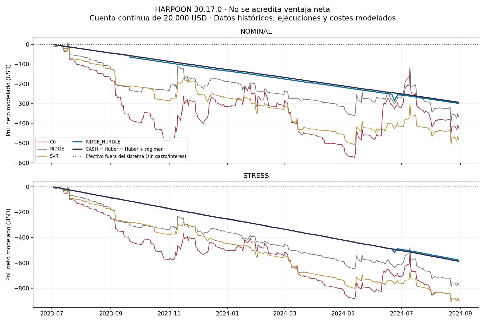

# HARPOON XXXUltimate 30.17.0

**Core corregido. Ventaja neta no demostrada. Nivel 8 no acreditado.**

Esta integral conserva la aplicación, código, datos originales, estudios anteriores, modelos diagnósticos, pruebas y nuevas evidencias. No se ha desplegado ni conectado a un broker.

Empieza por [LEEME_30_17_0.txt](LEEME_30_17_0.txt) y el [informe YAML completo](EVALUACION_ECONOMICA_HARPOONX_30_17_0.yaml).

## Resultado del estudio finito

Cuenta continua de **20.000 USD**, 294 sesiones, julio de 2023 a agosto de 2024. Los precios son históricos; costes y ejecuciones son modelados. El TEST ya había sido visto: no es confirmación independiente.

| Política | Neto nominal | Neto estrés | Campañas nominal / estrés |
|---|---:|---:|---:|
| Motor histórico C0 | −424,94 USD | −893,68 USD | 226 / 226 |
| Ridge anterior | −366,88 USD | −773,98 USD | 91 / 91 |
| SVR anterior | −481,56 USD | −893,63 USD | 86 / 86 |
| Ridge + incertidumbre/costes | −299,60 USD | −578,35 USD | 3 / 1 |
| Huber + incertidumbre/costes | −294,00 USD | −588,00 USD | 0 / 0 |
| Huber + régimen + caps reducidos | −294,00 USD | −588,00 USD | 0 / 0 |
| CASH con el mismo gasto externo | −294,00 USD | −588,00 USD | 0 / 0 |

Abstenerse evitó operaciones sin margen suficiente; **no produjo beneficio**. El resultado de una sola operación en estrés no demuestra una estrategia ganadora. No se bajaron los umbrales para buscar un resultado favorable.



## Qué cambió

- Máximo patrimonial actualizado por todos los eventos causalmente conocidos, no sólo por señales admitidas.
- Ajuste causal de precio, VWAP y volumen por splits, incluyendo benchmark.
- Tres recetas fijas con abstención y costes; la tercera reduce exposición/riesgo a la mitad.
- Reserva única **29 → 41 / 128** y verificación completa de fuentes y derivaciones antes del replay.
- Comparaciones pareadas frente a CASH, C0 y Ridge; dos longitudes de bloque y multiplicidad explícita.
- Auditoría de 14 cuentas y reproducción exacta de **25 archivos**.

**Pruebas:** 483 de Python quant; 106 de Ultimate aprobadas y 1 omitida; 52 de herramientas históricas; 32 de registro/verificación; 4 regresiones nuevas de core. Algunas suites son solapadas: no se suman como una nota de calidad. Compilación, typecheck y `npm test` aprobados. Una prueba opcional de paridad con runtime antiguo se omite; el código original tiene su reproducción separada de 12 archivos.

## Reproducir sin cuenta ni red de mercado

```bash
npm ci
python -m pip install -r quant/requirements-tested.txt
npm run build:xxx
python tools/run_quant8.py --output-dir evidence/core_quant8_30_17_0/reproduction_user --verify-against evidence/core_quant8_30_17_0/run_completed
```

La salida debe ser nueva. La reserva existente se verifica, no se reinicia. Las recetas históricas no son modelos aprobados para producción.

```bash
npm run test:quant8
npm run test:ultimate
npm run typecheck:xxx
PYTHONPATH=quant python -m unittest discover -s quant/tests -v
```

## Qué impide acreditar 8

No existe crecimiento neto positivo ni ventaja sobre CASH. Faltan confirmación temporal genuinamente nueva, costes/fills observados y certificación completa de acciones corporativas. Los datos parciales 2016–2026 del trabajo interrumpido no se recuperaron; no se presentan como incluidos. ALPACA_PROXY no es London Strategic Edge.

El YAML propone una rúbrica de aceptación y soluciones posteriores: asignación robusta con covarianza regularizada, reversión residual como challenger aún no validado a 72 horas y opciones bloqueadas por falta de cadenas observadas. Ninguna de esas propuestas equivale a beneficio probado.

La [documentación 30.16](docs/legacy_30_16_0/README.md), sus resultados originales y el código congelado se conservan. El despliegue sigue diferido.
