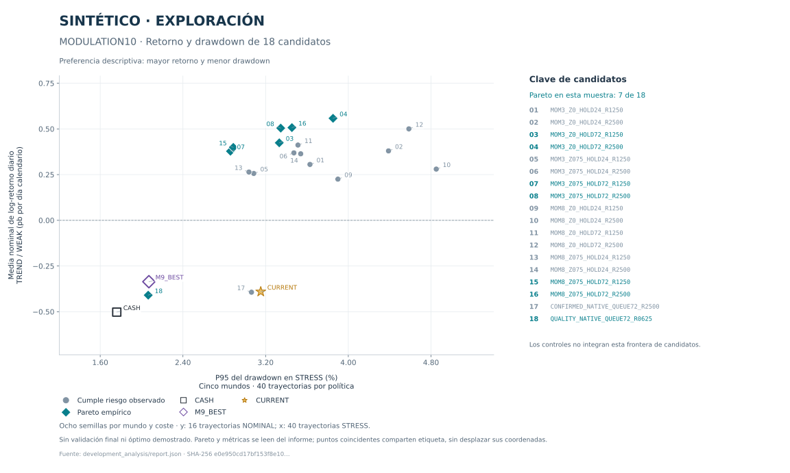

# HarpoonX: cierre de la ronda M10 y continuación hacia N9-S

## Resultado

**La ronda produjo mejora descriptiva en TREND, pero cero candidatos elegibles para validación. N9-S no está alcanzado.** Se ejecutaron 1.840 cuentas sintéticas de desarrollo y se conservaron cerradas las 3.200 cuentas reservadas del final. La próxima unidad de trabajo aborda la equivalencia financiera del simulador antes de otra búsqueda de señales.

La selección registrada fue `QUALITY_NATIVE_QUEUE72_R0625`, con margen de desarrollo −1,5679645503 pb/día. Ese número es el margen mínimo frente a los umbrales después de restar 1,645 errores estándar: no es una rentabilidad ni una puntuación de calidad. El código rehúsa abrir el final con este resultado. CASH y M9_BEST obtuvieron márgenes descriptivos menos negativos; ninguno habilita sustituir la selección ni declarar éxito.

## Qué se ejecutó

- 16 modulaciones de momentum: ventanas de 3/8 sesiones completas; score mayor que 0/0,75; riesgo inicial 0,125%/0,25%; stop inicial y salida a 24/72 horas, sin targets, parciales ni trailing.
- Dos ablaciones que cambian exclusivamente la recepción del trailing, conservando la misma entrada, riesgo y función de stop nativa.
- Cinco controles: CURRENT, SIMPLE, CASH, M9_BEST y QUALITY_NATIVE72_R0625.
- Cinco mundos: TREND, WEAK, FALSE, NULL y GAP. Ocho semillas por mundo, dos costes. Las mismas trayectorias comparan políticas y costes.
- Capital compartido de 20.000 USD, 126 sesiones y 176 días calendario. Se conservaron generador, comisiones, fricción, coste fijo, límites y hurdle. El 12% limita admisión/reserva; no garantiza exposición continua.

Los 16 momentum tuvieron media positiva en TREND tanto nominal como estrés. Ninguno de los 18 candidatos tuvo media positiva en WEAK, FALSE o NULL en ninguno de los dos costes. Hubo dos grupos positivos en GAP nominal y ninguno en GAP estrés: 34 de 180 grupos candidato×mundo×coste positivos, todos descriptivos. Las 18 recetas cumplieron el filtro de riesgo observado en esta muestra.

## Retorno neto y riesgo

Cada neto es la media de ocho trayectorias durante todo el periodo, después de costes, en USD. El P95 agrega las 40 trayectorias STRESS de los cinco mundos; no es el peor drawdown ni una cota poblacional.

| Política | TREND nominal | TREND estrés | WEAK nominal | WEAK estrés | P95 DD estrés |
|---|---:|---:|---:|---:|---:|
| `MOM8_Z075_HOLD72_R1250` | +484.29 | +221.30 | -193.22 | -392.42 | 2.888% |
| `MOM3_Z0_HOLD72_R2500` | +629.95 | +384.70 | -220.67 | -481.38 | 3.852% |
| `QUALITY_NATIVE_QUEUE72_R0625` | -108.04 | -292.82 | -179.13 | -366.53 | 2.064% |
| `M9_BEST` | -61.73 | -259.09 | -173.55 | -363.31 | 2.071% |
| `CURRENT` | -90.33 | -308.03 | -183.05 | -389.93 | 3.153% |
| `CASH` | -176.00 | -352.00 | -176.00 | -352.00 | 1.760% |

`MOM8_Z075_HOLD72_R1250` representa un compromiso descriptivo útil para investigar: media conjunta nominal TREND/WEAK de +0,3990 pb/día y P95 de DD estrés de 2,8877%. Su peor DD entre todas las trayectorias fue 3,2088%. En TREND nominal ganó 484,29 USD de media, frente a −61,73 USD del control M9_BEST en esos mismos caminos; en WEAK nominal perdió 193,22 USD. No fue el ganador del criterio robusto registrado y no se promueve.

`MOM3_Z0_HOLD72_R2500` obtuvo la mayor media conjunta nominal (+0,5580 pb/día), pero elevó el P95 de DD estrés a 3,8522% y su peor DD observado a 5,1085%. Aumentar el riesgo mejoró esa media y empeoró la protección; no resolvió WEAK. No existe aquí un óptimo global demostrado.

La frontera contiene siete candidatos no dominados en los dos ejes elegidos, excluyendo controles como establecía el protocolo. Promediar TREND y WEAK puede ocultar pérdidas en WEAK; por eso esa frontera no reemplaza las condiciones por mundo de la selección.



## Ablación del trailing

Para CONFIRMED, cambiar sólo la cola de recepción redujo el neto medio de TREND nominal en 12,09 USD y el P95 de drawdown en 0,2045 puntos porcentuales; en WEAK nominal mejoró el neto 9,96 USD. En WEAK estrés la diferencia fue −0,29 USD. Para QUALITY, TREND nominal cambió −10,80 USD, mientras WEAK nominal mejoró 0,76 USD. Los signos son mixtos y los tamaños se presentan con incertidumbre descriptiva en el JSON. Corregir la recepción es una mejora de fidelidad operativa; la muestra no demuestra un aumento general de rentabilidad.

## Barrera matemática y siguiente hipótesis

El diagnóstico determinista de WEAK, sin generar mercados ni ensayar políticas, calcula una cota de crecimiento logarítmico neto esperado de 0,7628380849 pb/día para desarrollo y 0,9051232470 para el extremo favorable del soporte final. Ambas están por debajo del hurdle nominal de 1 pb/día. La clase concede conocimiento causal del régimen actual, omite costes variables y permite apreciación posterior a la admisión durante 72 horas. Usa una cuenta sombra para tratar correctamente el coste fijo y la desigualdad de Doob para acotar la apreciación.

La [demostración y cálculo](MODULATION10_FEASIBILITY.md) están vinculados por hashes a la ley registrada. Su referencia matemática primaria es [Amir Dembo, Probability Theory, corolario 5.2.13](https://web.stanford.edu/class/stats310c/NOTES/lnotes.pdf). Es una cota de esperanza bajo supuestos; no impide que una muestra finita o una trayectoria supere ese valor por azar. La aritmética se reprodujo byte por byte y pasó doce autocomprobaciones; no es una prueba formal por intervalos ni auditoría externa.

**La cota todavía no certifica la imposibilidad del replay nativo.** El análisis de [brechas de ejecución](MODULATION10_EXECUTION_GAPS.md) precisa dos cuestiones: reservas/IOC frente a valoración contemporánea, y pagos OHLC frente a operaciones sobre los ocho subpasos generados. El segundo punto tiene un contraejemplo local: con los mismos costes, un stop puede cobrar 99,00 en el replay frente a 98,77 al primer precio discreto que cruza. Los targets y el orden intrabar pueden producir el signo contrario, por lo que no se atribuye un sesgo agregado sin compararlo.

La siguiente unidad primero implementa cuatro familias de fixtures y una exportación de subpasos que reconstruya exactamente los mismos OHLCV y señales. Sólo si hace falta cuantificar la diferencia se registrará un diagnóstico excluido de selección, con la receta fija CONFIRMED_NATIVE_QUEUE72_R2500 y desarrollo ya abierto: 240 cuentas si se cierra el lema de reservas, o 400 como máximo para separar también un guard contemporáneo. No se usarán las semillas finales selladas. Estos son nuevos cargos de presupuesto, no simulaciones gratuitas por reutilizar precios.

## Verificación y hallazgo contable

El [workflow focal](https://github.com/blyat-enterteiment/HarpoonX/actions/runs/42405166152) pasó Ruff, mypy en cuatro fuentes, 47 pruebas Python nuevas, 60 heredadas y 112 Node: 219 pruebas. Los nueve hashes nuevos y 47 heredados coincidieron. Las correcciones de imports, tipos y permisos se realizaron antes de medir resultados; se retuvieron los registros sustituidos. No se afirma que toda la CI histórica esté verde: siguen documentados los bloqueos de procedencia de fases anteriores.

La revisión contable se ejecutó con una implementación separada, sin importar generador, replay ni helpers del analizador, usando Decimal de 40 dígitos. Reconstruyó 1.840 cuentas, 79.565 campañas, 83.785 fills de salida y 231.840 puntos de curva. La diferencia máxima en neto fue 4,81×10⁻¹² USD y en equity final 4,59×10⁻¹² USD; ranking y ablaciones se reprodujeron.

**Estado: PASS_WITH_DIAGNOSTIC_FINDING.** En 58 cuentas, 66 campañas que son empate en Decimal aparecen como ganadoras por residuos binarios positivos, como máximo 2,899×10⁻¹³ USD. Se conservan 39.812 victorias según el neto publicado frente a 39.746 con Decimal. El conteo exacto de victorias no coincide; se informa expresamente. No se cambiaron netos, datos ni ranking para resolverlo. El auditor valida el win rate publicado contra sus propios signos y rechaza diferencias monetarias materiales.

La revisión separada es interna, no externa. Los archivos compactos permiten reconciliar fills y curvas, pero no reconstruir por sí solos cada extremo intrabar ni demostrar la ejecutabilidad de un precio OHLC. Permanecen pendientes el modelo completo de parciales/rechazos/outages/impacto y la integración completa del coordinador de celdas virtuales. Ambos siguen bloqueando N9-S.

## Presupuesto y ejecución

La ejecución de desarrollo tardó 87.658 segundos, con cuatro workers, Python 3.12.14 y Node v24.22.1. Se ejecutó una sola vez. Las pruebas remotas utilizaron Python 3.12.16 y Node 22.23.4. Es un benchmark de esta máquina y carga, no una promesa de latencia.

M9 y M10 suman 7.520 cuentas ejecutadas en estas dos rondas. El conteo histórico provisional de 151 unidades política×coste frente al techo original de 128 permanece sin reconciliar; los suplementos registrados de 78 y 46 unidades se conservan separados y suman 275 en esa contabilidad. Esas unidades no son cuentas ni semillas independientes. La continuación autorizada no borra la deuda histórica.

El programa prospectivo reserva α total nominal 0,05 con gasto geométrico por intento final. M10 no abrió final y no gastó ese α prospectivo. El registro de 50 endpoints y 50.000 remuestreos se mantiene; una cadena explicativa heredada aún menciona 40, pero el contrato estadístico ejecutable usa 50. El bootstrap no se presenta como garantía exacta finita ni como corrección retroactiva de búsquedas históricas.

## Artefactos y reproducción

- [Protocolo](../research/modulation10/protocol.json), [registro actual](../research/modulation10/registration.json) y [cierre](../evidence/modulation10/closure.json).
- [Reporte completo](../evidence/modulation10/development_analysis/report.json), [selección](../evidence/modulation10/development_analysis/selection.json) y [auditoría](../evidence/modulation10/qa/independent_review.json).
- [Programa continuo](../research/continuous_n9/program.json), [estado](../research/continuous_n9/state.json) y [tarea](../research/continuous_n9/task_prompt.txt).
- [Datos sintéticos brutos](https://chatgpt.com/library?file_id=libfile_2a43d8459c048191ad1cf3da85a73f12&account_id=personal); SHA-256 `26db8f357ea683d91ae0b0b1beb3277608036cd1c1dc419cdcd73d489c64c49d`.

El código económico quedó fijado en `b34806f7b2a059e440071811aa769a5540badb7b`; el protocolo se publicó antes de resultados en `23dbe2e1378fc24bb7729968073bd1b948c90eab`. Los cambios se conservan como [PR #7 en borrador](https://github.com/blyat-enterteiment/HarpoonX/pull/7), sin merge.

```bash
PYTHONPATH=quant:tools python -c "from run_modulation10 import verify_registration; verify_registration()"
python -B tools/audit_modulation10_results.py
python -B tools/diagnose_modulation10_feasibility.py
```

Para reconstruir el análisis, extraer los datos brutos en la raíz del checkout y usar un directorio de salida nuevo:

```bash
PYTHONPATH=quant:tools python tools/analyze_modulation10.py --stage development --input-dir evidence/modulation10/development --output-dir /tmp/harpoon_m10_analysis_reproduced
```

No volver a ejecutar el mercado para auditar resultados existentes: el registro de intentos bloquea la repetición de la etapa y conserva su presupuesto. La reanudación programada y su identificador exacto figuran en el estado cuando la creación de la tarea haya sido confirmada.

## Catálogo completo medido

Los netos son USD; margen y media son pb de log-retorno por día calendario. La media conjunta sólo agrega TREND/WEAK nominal; el margen incorpora las cuatro condiciones TREND/WEAK × nominal/estrés.

| Política | TREND nominal | WEAK nominal | Media conjunta pb/día | P95 DD estrés | Margen pb/día | Pareto candidatos |
|---|---:|---:|---:|---:|---:|---:|
| `MOM3_Z0_HOLD24_R1250` | +439.78 | -215.64 | +0.3057 | 3.6290% | -1.9005 | No |
| `MOM3_Z0_HOLD24_R2500` | +538.73 | -257.99 | +0.3797 | 4.3887% | -2.1702 | No |
| `MOM3_Z0_HOLD72_R1250` | +523.20 | -213.33 | +0.4240 | 3.3319% | -1.9528 | Sí |
| `MOM3_Z0_HOLD72_R2500` | +629.95 | -220.67 | +0.5580 | 3.8522% | -2.1482 | Sí |
| `MOM3_Z075_HOLD24_R1250` | +386.78 | -199.27 | +0.2564 | 3.0851% | -1.8594 | No |
| `MOM3_Z075_HOLD24_R2500` | +481.61 | -211.46 | +0.3690 | 3.4736% | -2.0190 | No |
| `MOM3_Z075_HOLD72_R1250` | +484.45 | -208.64 | +0.3779 | 2.8596% | -1.9243 | Sí |
| `MOM3_Z075_HOLD72_R2500` | +581.69 | -212.49 | +0.5044 | 3.3462% | -2.0865 | Sí |
| `MOM8_Z0_HOLD24_R1250` | +414.66 | -247.27 | +0.2252 | 3.8992% | -2.1007 | No |
| `MOM8_Z0_HOLD24_R2500` | +512.39 | -301.68 | +0.2802 | 4.8506% | -2.4321 | No |
| `MOM8_Z0_HOLD72_R1250` | +498.31 | -197.74 | +0.4117 | 3.5129% | -2.0143 | No |
| `MOM8_Z0_HOLD72_R2500` | +600.15 | -231.48 | +0.5004 | 4.5856% | -2.3297 | No |
| `MOM8_Z075_HOLD24_R1250` | +409.95 | -215.97 | +0.2642 | 3.0388% | -1.9038 | No |
| `MOM8_Z075_HOLD24_R2500` | +507.09 | -239.33 | +0.3638 | 3.5395% | -2.0855 | No |
| `MOM8_Z075_HOLD72_R1250` | +484.29 | -193.22 | +0.3990 | 2.8877% | -1.8648 | Sí |
| `MOM8_Z075_HOLD72_R2500` | +583.56 | -211.98 | +0.5072 | 3.4544% | -2.0406 | Sí |
| `CONFIRMED_NATIVE_QUEUE72_R2500` | -102.42 | -173.09 | -0.3933 | 3.0634% | -1.6304 | No |
| `QUALITY_NATIVE_QUEUE72_R0625` | -108.04 | -179.13 | -0.4096 | 2.0643% | -1.5680 | Sí |
| `CURRENT` | -90.33 | -183.05 | -0.3905 | 3.1530% | -1.6297 | Control |
| `SIMPLE` | -9.00 | -265.23 | -0.3936 | 4.0707% | -1.9640 | Control |
| `CASH` | -176.00 | -176.00 | -0.5022 | 1.7600% | -1.5022 | Control |
| `M9_BEST` | -61.73 | -173.55 | -0.3358 | 2.0708% | -1.5486 | Control |
| `QUALITY_NATIVE72_R0625` | -97.24 | -179.89 | -0.3954 | 2.0713% | -1.5677 | Control |
